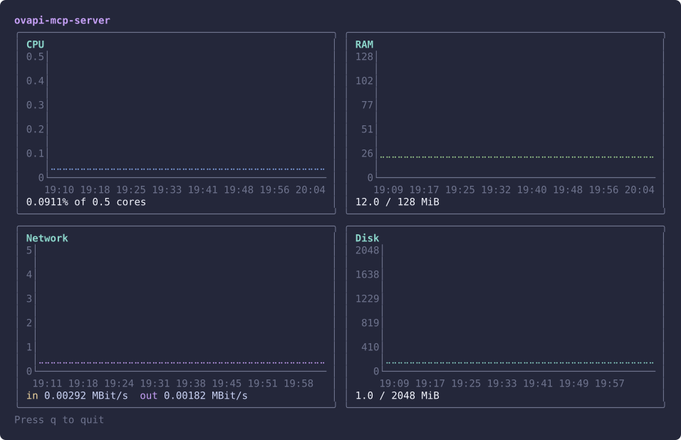

# runway-stats

A terminal dashboard for monitoring [Runway](https://www.runway.horse) app resources. Displays CPU, RAM, Network I/O, and Disk usage as line charts scaled to your plan's limits.

Built with [Bubble Tea v2](https://github.com/charmbracelet/bubbletea), [Lip Gloss v2](https://github.com/charmbracelet/lipgloss) and [ntcharts](https://github.com/NimbleMarkets/ntcharts).



## Prerequisites

- Go 1.26.8+
- [Runway CLI](https://www.runway.horse/docs/cli/install/) v1.49.0 or newer, installed and logged in

## Install

```
go build -o runway-stats .
```

## Usage

```
runway-stats [flags] <app-name> [app-name...]
```

### Examples

```bash
# Single app
runway-stats my-app

# Multiple apps, stacked
runway-stats my-app my-other-app

# Custom time range and refresh interval
runway-stats --interval=6h --refresh=30s my-app
```

### Flags

| Flag | Default | Description |
|------|---------|-------------|
| `--interval` | `1h` | Stats time range (e.g. `1h`, `6h`, `24h`) |
| `--refresh` | `60s` | How often to re-fetch data |

Each chart's value axis runs from zero to the plan limit (0.5 cores, 128 MiB, …), so the line shows how close you are to it; if there is no limit or usage exceeds it, the axis fits the data instead. Network shows incoming and outgoing traffic as two lines. Charts grow with the terminal height and shrink as you add apps.

A panel turns yellow when its latest value is above the warning threshold Runway reports for your plan, and red above the critical threshold.

Press `q` or `Ctrl+C` to quit.

## Updating the screenshot

```bash
go build -o runway-stats .
tmux new-session -d -s shot -x 110 -y 34 "./runway-stats my-app"
sleep 5 && tmux capture-pane -e -p -t shot > shot.ansi && tmux kill-session -t shot
python3 scripts/ansi2svg.py shot.ansi docs/screenshot.svg
```
